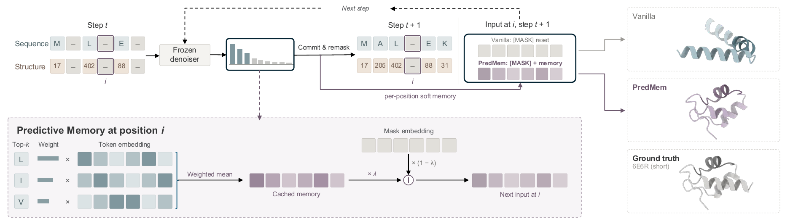

# PredMem: Predictive Memory for Multimodal Protein Generation

[](https://arxiv.org/abs/2611.32347)

Official implementation for [*Beyond Hard Tokens: Predictive Memory for Multimodal Protein Generation*](https://arxiv.org/abs/2611.32347).

<p align="center">
  
</p>
<p align="center"><em>Figure 1. Predictive Memory across masked-decoding steps.</em></p>

## Overview

PredMem is a training-free inference method for multimodal protein language models. At each decoding step, it caches a summary of the model's predictions and carries it forward to the next step. Sequence and structure can refine each other before the model commits their tokens.

This release supports ESM3, DPLM-2, and DPLM-2.1 for unconditional sequence–structure co-generation, motif scaffolding, structure prediction, and inverse folding.

## Method

1. **Summarize.** Compute a probability-weighted embedding of the top *k* tokens from the denoiser's raw scores.
2. **Cache.** Store the summary by residue, modality, and guidance branch. Each step refreshes the cache.
3. **Read.** Blend the previous summary with the mask embedding at eligible unresolved positions. Fixed conditions are protected, and the recurrence adds zero denoiser calls.

## Installation

Set up the Python 3.10 DPLM environment for DPLM inference and evaluation, and the Python 3.12 ESM3 environment for ESM3 inference. The [environment guide](environments/README.md) provides the CUDA 12.1 setup commands and frozen dependencies.

## Checkpoints and data

| Asset | Expected location or use |
| --- | --- |
| DPLM-2 and DPLM-2.1 checkpoints | The recipes load `airkingbd/dplm2_650m` and `airkingbd/dplm2_bit_650m` through the DPLM backend. |
| ESM3 checkpoint | The recipes load `esm3-open` through the ESM3 backend. |
| CAMEO 2022, PDB Date Split, and motif benchmark | Extract the archives to `data/`. See the [benchmark data guide](docs/DATA.md) for filenames and checksums. |
| ESMFold and Foldseek | Evaluation uses `facebook/esmfold_v1` for refolding and Foldseek for clustering. Use the `foldseek` on `PATH` or set `PM_FOLDSEEK` to the executable path. See the [environment guide](environments/README.md#foldseek). |

Use the upstream access instructions for the model weights. Prepare the benchmark archives with `scripts/prepare_data.py` as described in the [data guide](docs/DATA.md).

## Generation and evaluation

Once the environments, weights, and data are ready, run from the repository root:

```bash
PM_FOLDSEEK=/path/to/foldseek bash run_PredMem.sh --gpus 0,1,2,3
```

Each recipe runs once with seed 42 by default. To change it, edit `sampling.seeds` in [`configs/base.yaml`](configs/base.yaml). The launcher runs one job per selected GPU and writes `benchmark_summary.md`, `benchmark_summary.tex`, and `benchmark_metrics.csv` under `outputs/paper/`. Rerun the same command to resume. Use `--main-only` for the joint and motif benchmarks and `--dry-run` to list the planned jobs.

Set `PM_DPLM_PYTHON` and `PM_ESM3_PYTHON` to reuse existing environments. Use `--output PATH` for a separate run and `--report-only` to export the metrics from that run's completed evaluations.

To run an individual recipe, activate the environment for its model. Use the same recipe for generation and evaluation.

```bash
source .venv-dplm/bin/activate
export PM_FOLDSEEK=/path/to/foldseek
recipe=configs/models/dplm21/joint/cfg_pm.yaml
predmem run --config "$recipe"
predmem evaluate --config "$recipe"
predmem analyze --config "$recipe"
```

Each model has four recipes for joint generation and motif scaffolding: `vanilla.yaml`, `pm.yaml`, `cfg.yaml`, and `cfg_pm.yaml`. The single-modality tasks provide Default, Vanilla, and PredMem recipes for CAMEO 2022 and PDB Date Split. For ESM3 generation, activate `.venv-esm3` and switch to `.venv-dplm` for evaluation.

DPLM-2.1 motif scaffolding uses λ=0.3 and k=3 for PredMem and CFG+PredMem. ESM3 motif counts the residues outside the fixed motif when setting the step budget, while the paper describes the full length. The ESM3 CAMEO 2022 PredMem structure-prediction recipe is an additional validation, and Table 10 leaves that entry blank.

## Paper results

Mean success rates (%) across five runs from [Tables 1 and 2](https://arxiv.org/html/2611.32347v1).

| Task | Model | Vanilla | PredMem | CFG | CFG+PredMem |
| --- | --- | ---: | ---: | ---: | ---: |
| Co-generation | DPLM-2 | 29.80 | 33.40 | 31.88 | **34.20** |
| Co-generation | DPLM-2.1 | 28.88 | 46.60 | 32.88 | **48.32** |
| Co-generation | ESM3 | 33.36 | **82.08** | 64.48 | 80.96 |
| Motif scaffolding | DPLM-2 | 20.60 | **21.71** | 20.48 | 21.25 |
| Motif scaffolding | DPLM-2.1 | 18.33 | 20.29 | 19.07 | **21.08** |
| Motif scaffolding | ESM3 | 30.43 | **42.40** | 35.81 | 41.93 |

The benchmark summary includes structural self-consistency, successful clusters, refolding confidence for co-generation, and solved variants for motif scaffolding. The default suite adds structure prediction and inverse folding metrics for Table 10. See the [evaluation protocol](docs/DIVERSITY.md) for definitions.

## Repository layout

```text
run_PredMem.sh                   Benchmark entry point
configs/models/                 YAML recipes for DPLM-2, DPLM-2.1, and ESM3
PredMem/runner.py               Benchmark scheduling
PredMem/backends/                Model-specific inference adapters
PredMem/vendor/                 PredMem memory and sampling hooks
PredMem/evaluation.py             Refolding, quality metrics, and clustering entry point
PredMem/reporting.py             Benchmark summary and metrics export
environments/                   Installation commands and frozen dependencies
scripts/prepare_data.py         Benchmark archive preparation
docs/                           Data and evaluation protocols
assets/predmem-overview.png     Paper Figure 1
upstream/                       Vendored models and evaluation tools
```

## Citation

If you use PredMem, please cite:

```bibtex
@article{shi2026predmem,
  title={Beyond Hard Tokens: Predictive Memory for Multimodal Protein Generation},
  author={Shi, Xiaoliang and Wang, Zichen and Wei, Zhijian and Shi, Zhanpeng
          and Zhou, Zhenghong and Wang, Yunpeng and Zheng, Shuangjia},
  journal={arXiv preprint arXiv:2611.32347},
  year={2026},
  url={https://arxiv.org/abs/2611.32347}
}
```

## License

PredMem's original code is released under the [MIT License](LICENSE).
